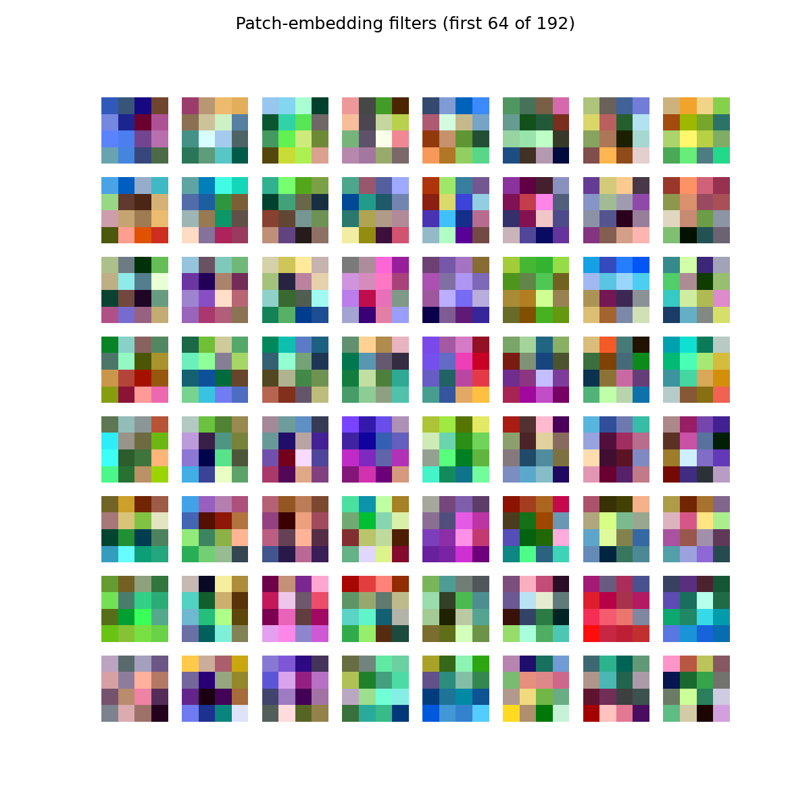
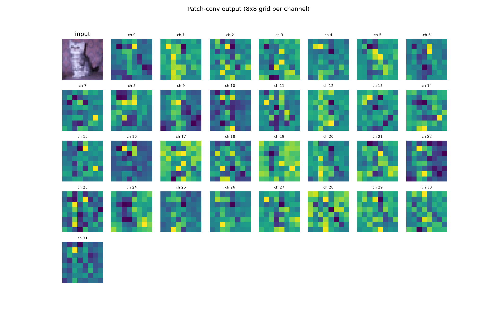
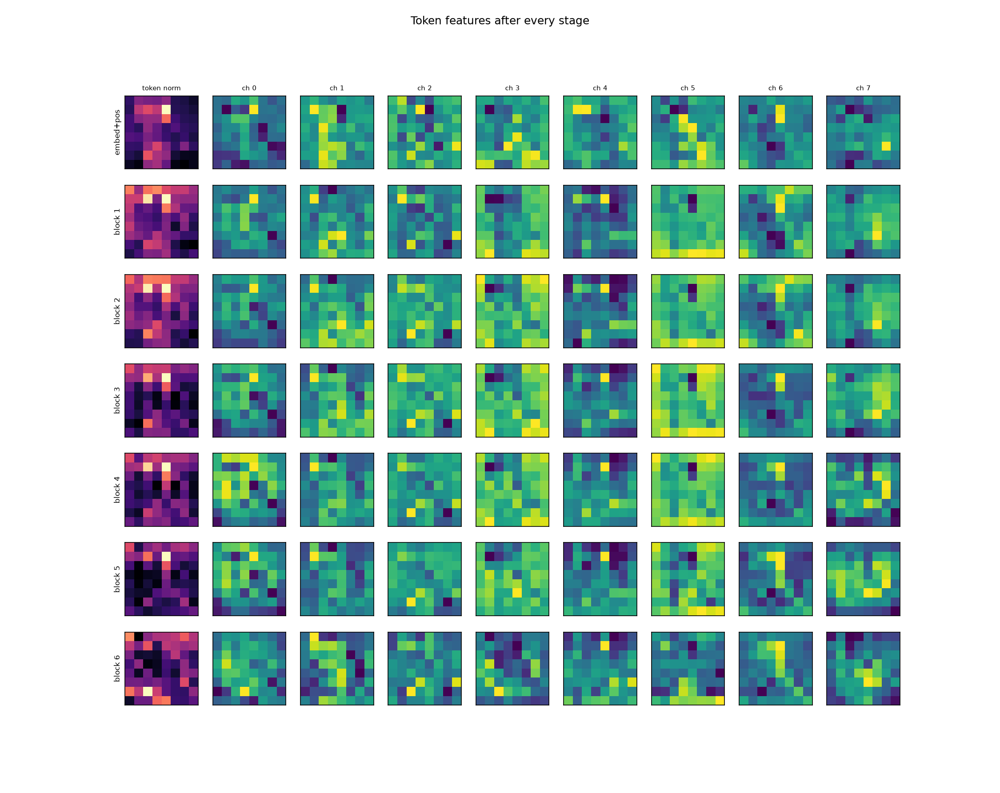
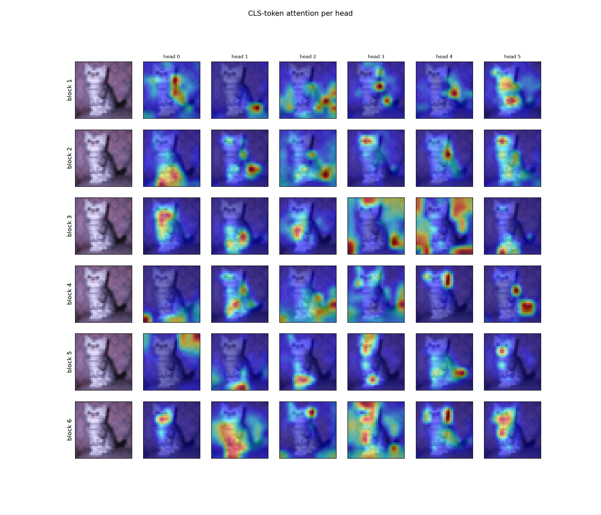
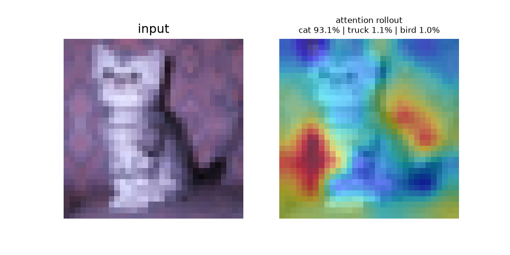
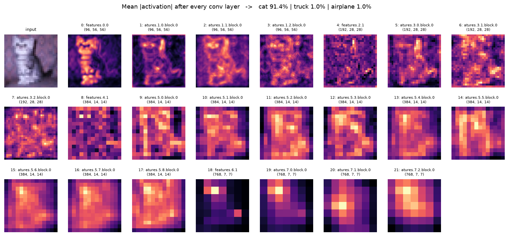
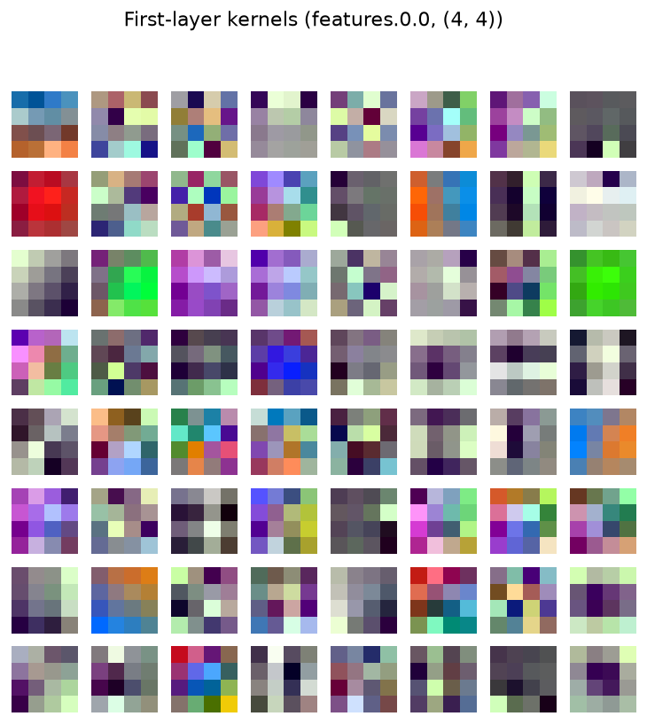
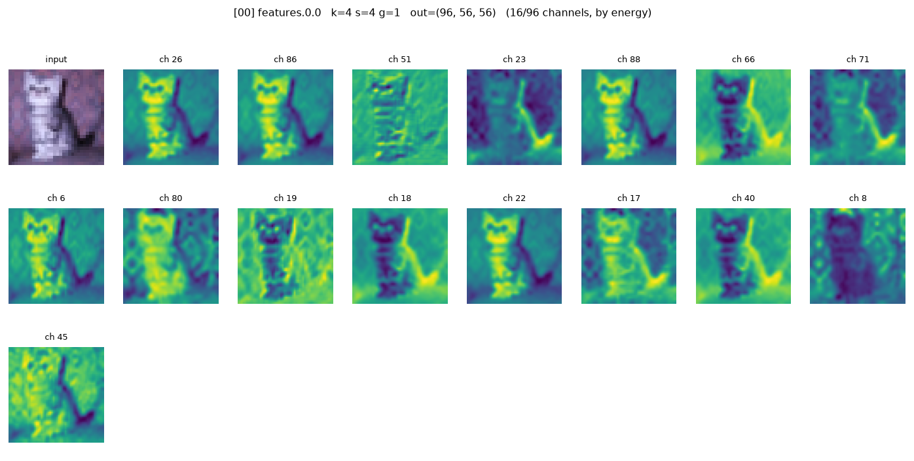
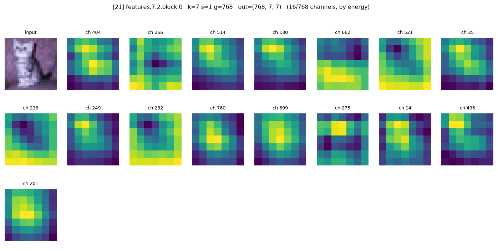

# CIFAR-10 Classification: Vision Transformer vs. ConvNeXt-Tiny

A guide to two models trained on CIFAR-10, covering their architecture, how an image's shape changes at every step, and what each visualization figure means.

> **Before you read:** the images are not bundled in this file. They are produced by the scripts `visualize.py` (ViT) and `cnn_visualize.py` (ConvNeXt). Put this file in the folder that contains the output folders `viz/` and `viz_cnn/` and the image links below will render. The result tables in sections 3.6 and 6 are left blank on purpose. Fill them in after you run the training scripts.

## Contents

1. [Project overview](#1-project-overview)
2. [Part A: Vision Transformer (ViT)](#2-part-a-vision-transformer-vit) (architecture, dimension flow)
3. [ViT: visualization figures and results](#3-vit-visualization-figures-and-results)
4. [Part B: ConvNeXt-Tiny](#4-part-b-convnext-tiny) (architecture, dimension flow)
5. [ConvNeXt: visualization figures](#5-convnext-visualization-figures)
6. [Results and comparison](#6-results-and-comparison)
7. [How to reproduce](#7-how-to-reproduce)

---

## 1. Project overview

| | |
|---|---|
| **Dataset** | CIFAR-10: 50,000 labelled 32×32 RGB images, 10 classes (airplane, automobile, bird, cat, deer, dog, frog, horse, ship, truck) |
| **Split** | Stratified: 40,000 train / 10,000 validation (1,000 validation images per class, seed 42) |
| **Goal** | Train strong classifiers, then look inside them to see what they learn |

**Starting point (from the original notebooks)**

| Model | Result |
|---|---|
| Linear classifier (Keras, flatten → dense) | about 43% validation accuracy |
| Small MLP (Keras, 128 hidden units) | about 47% validation accuracy |
| First ViT draft (patch 8, dim 32, lr 0.01, no augmentation) | about 53% **training** accuracy after 10 epochs |

---

## 2. Part A: Vision Transformer (ViT)

### 2.1 The idea in one paragraph

A ViT cuts the image into small square patches, turns each patch into a vector (a *token*), and lets the tokens exchange information through self-attention. A special **CLS token** collects the information, and a small classifier reads it at the end.

### 2.2 Tuned configuration

| Setting | Original notebook | Tuned (`train.py`) |
|---|---|---|
| Patch size | 8 (16 tokens) | **4** (64 tokens) |
| Embedding dim | 32 | **192** |
| Attention heads | 4 | **6** (32 channels per head) |
| Transformer blocks | 4 | **6** |
| MLP hidden dim | 64 | **384** |
| Optimizer | Adam, lr 0.01 | **AdamW**, lr 1e-3, weight decay 0.05, 5-epoch warmup then cosine decay |
| Regularization | none | dropout 0.1, label smoothing 0.1 |
| Augmentation | none | random crop (4px padding) + horizontal flip |
| Input scaling | ÷255 only | per-channel mean/std normalization |
| Epochs / batch size | 10 / 64 | 100 / 128 |
| Parameters | n/a | about **1.81 M** |

### 2.3 Architecture diagram

```
 Image 3×32×32
      │
      ▼
 ┌───────────────────────────┐
 │ Patch embedding           │  Conv2d(3→192, kernel 4, stride 4)
 └───────────────────────────┘
      │  64 patch tokens, each 192-dim
      ▼
 prepend CLS token  →  add position embedding  →  dropout
      │  65 tokens × 192
      ▼
 ┌───────────────────────────┐
 │ Transformer block  × 6    │
 │  ├─ LayerNorm             │
 │  ├─ Multi-head attention  │  6 heads × 32 ch   (+ residual)
 │  ├─ LayerNorm             │
 │  └─ MLP 192→384→192       │  GELU              (+ residual)
 └───────────────────────────┘
      │  65 × 192
      ▼
 final LayerNorm → take CLS token (index 0) → Linear 192→10
      │
      ▼
 10 class scores (logits)
```

### 2.4 Dimension flow (one image, batch = 1)

| # | Operation | Output shape | What happens |
|---|---|---|---|
| 0 | Input image | `3 × 32 × 32` | RGB image, normalized |
| 1 | Patch conv `Conv2d(3→192, k=4, s=4)` | `192 × 8 × 8` | Each non-overlapping 4×4×3 patch (48 numbers) becomes 192 numbers |
| 2 | Flatten + transpose | `64 × 192` | 8×8 = 64 patches, each a 192-dim vector |
| 3 | Prepend CLS token | `65 × 192` | One learnable "summary" token is added at index 0 |
| 4 | Add position embedding | `65 × 192` | Learnable vector per position, so the model knows where each patch came from |
| 5 | Dropout | `65 × 192` | Regularization during training only |

**Inside one transformer block (repeated 6 times)**

| # | Operation | Output shape | What happens |
|---|---|---|---|
| a | LayerNorm | `65 × 192` | Normalizes each token |
| b | Q/K/V projection (one Linear 192→576) | `65 × 576` | Produces Q, K and V together (3 × 192) |
| c | Split into 6 heads | Q, K, V each `6 × 65 × 32` | Each head gets 32 channels of Q, 32 of K and 32 of V |
| d | Attention scores `softmax(Q·Kᵀ/√32)` | `6 × 65 × 65` | Per head: how much each token looks at every other token |
| e | Weighted sum of V | `6 × 65 × 32` | Each token mixes the values of the tokens it attends to |
| f | Concatenate heads | `65 × 192` | 6 × 32 = 192 |
| g | Output projection (Linear 192→192) | `65 × 192` | Mixes information across heads |
| h | Residual add | `65 × 192` | `x = x + attention_output` |
| i | LayerNorm | `65 × 192` | |
| j | MLP: Linear 192→384, GELU, Linear 384→192 | `65 × 192` | Per-token feed-forward network |
| k | Residual add | `65 × 192` | `x = x + mlp_output` |

**Classifier head**

| # | Operation | Output shape |
|---|---|---|
| 6 | Final LayerNorm | `65 × 192` |
| 7 | Take CLS token (index 0) | `192` |
| 8 | Linear 192→10 | `10` logits, then softmax gives class probabilities |

> **Common mix-up:** the sequence has **65** tokens (64 patches + CLS), not 64. Inside attention, the data is a flat list of tokens `(65 × 32)` per head. The 8×8 grid layout is only used when drawing figures.

---

## 3. ViT: visualization figures and results

Run: `python visualize.py --ckpt vit_best.pt --image cat.png` (or `--data cifar10_train.pt --index 7`). All figures go to `viz/`.

### 3.1 Figure 1: Learned patch filters



- **What it shows:** the weights of the patch-embedding convolution, drawn as tiny 4×4 RGB images. Each filter is a "template" it compares against every patch.
- **How to read it:** smooth colour blobs detect colour; striped or edge-like filters detect orientation and texture. Pure noise suggests the filters have not learned much.
- **Limit:** shows the first 64 of 192 filters.

### 3.2 Figure 2: Patch-conv output (feature maps)



- **What it shows:** the output of the patch convolution: 192 maps of size 8×8. One pixel in a map equals one image patch, and its brightness is how strongly that filter responded there.
- **Why it matters:** for each patch position, the 192 values across all maps form that patch's token. This is the transformer's first view of the image.
- **Limit:** shows the first 32 of 192 channels, chosen by index, so some may look meaningless.

### 3.3 Figure 3: Token features after every stage



- **Layout:** one row per stage (`embed+pos`, `block 1` … `block 6`). In each row, the first tile is the **token norm** (magma colours), then channels 0 to 7 (viridis).
- **What each tile is:** the 64 patch tokens at that stage, with one feature channel reshaped back into the 8×8 patch grid. The CLS token is dropped.
- **How to read it:** reading down a column shows one feature being rewritten block after block. Early rows reflect local patch content and the position embedding. Later rows usually look smoother as attention mixes neighbouring patches.

### 3.4 Figure 4: CLS attention per head



- **Layout:** rows are blocks (1 to 6). Columns are the input image, then heads 0 to 5.
- **How each tile is made:** take one head's `65×65` attention matrix, read row 0 (the CLS token), drop the CLS-to-CLS entry, reshape the remaining 64 values to 8×8, upsample and overlay on the image.
- **How to read it:** red means the CLS token attends strongly to that region. Heads often differ: one may focus on the object, another on the background or edges. Early blocks tend to be diffuse and the last block tends to focus on the object.
- **Caveat:** each tile is scaled on its own, so red in one tile is not comparable to red in another.

### 3.5 Figure 5: Attention rollout



- **What it shows:** a single map of which regions the final CLS token depends on, after combining all blocks and heads.
- **Why it's needed:** a patch's information gets mixed in block 1 before CLS ever looks at it in block 2. Looking at one block at a time misses this chain.
- **How it's computed:** for each block, average the attention over the 6 heads, add the identity matrix (for the residual connection), renormalize rows to sum to 1, then multiply across blocks: `R = A₆ · A₅ · … · A₁`. Row 0 of `R` (without CLS itself) is reshaped to 8×8 and overlaid on the image.
- **Layout:** input on the left, rollout overlay on the right. The title shows the top-3 predicted classes.
- **Caveat:** it averages over heads and ignores the MLPs and LayerNorms. It is an approximation of information flow, not proof of causation.

### 3.6 ViT results (fill in after training)

| Experiment | Best validation accuracy |
|---|---|
| Original notebook settings | _fill in_ |
| Tuned config, 100 epochs | _fill in_ |

Optional: `python train.py --sweep` adds one fix at a time (learning rate, patch size, dim, depth, augmentation, regularization) and writes `sweep_results.json`, so you can see what each change gained.

---

## 4. Part B: ConvNeXt-Tiny

### 4.1 The idea in one paragraph

ConvNeXt is a pure convolutional network, a ResNet modernized with ideas borrowed from transformers: a patchify stem, large 7×7 depthwise convolutions, LayerNorm and GELU, and an inverted-bottleneck MLP. It processes the image in four stages. Each stage halves the spatial size and doubles the channels. Here it starts from **ImageNet-pretrained weights** and is fine-tuned on CIFAR-10. Pretraining is why about 98% is reachable. From-scratch CNNs usually stall near 95%.

### 4.2 Fine-tuning configuration

| Setting | Value |
|---|---|
| Model | `convnext_tiny` (torchvision), ImageNet-1k pretrained, head replaced with 768→10 |
| Input | 32×32 image upscaled to **224×224** (bicubic), ImageNet mean/std |
| Optimizer | AdamW, lr 1e-4, weight decay 0.05 (no decay on norms and biases) |
| Schedule | 1 warmup epoch, then cosine decay, 10 epochs, batch size 64 |
| Regularization | label smoothing 0.1, gradient clipping 1.0 |
| Augmentation | random crop (4px padding) + horizontal flip, applied at 32×32 before upscaling |
| Precision | mixed precision (fp16) on GPU |
| Parameters | about 28 M |

### 4.3 Architecture diagram

```
 Image 3×32×32  →  bicubic upscale  →  3×224×224
      │
      ▼
 Stem: Conv 4×4, stride 4 (3→96) + LayerNorm            96 × 56 × 56
      │
      ▼
 Stage 1: 3 × ConvNeXt block                            96 × 56 × 56
      │   Downsample: LayerNorm + Conv 2×2, stride 2
      ▼
 Stage 2: 3 × ConvNeXt block                           192 × 28 × 28
      │   Downsample
      ▼
 Stage 3: 9 × ConvNeXt block                           384 × 14 × 14
      │   Downsample
      ▼
 Stage 4: 3 × ConvNeXt block                           768 ×  7 ×  7
      │
      ▼
 Global average pool → LayerNorm → Linear 768→10
```

**One ConvNeXt block** (the repeating unit):

```
 x ─┬────────────────────────────────────────────────────┐ (residual)
    ▼                                                    │
 Depthwise Conv 7×7  (C → C, one filter per channel)     │
    ▼                                                    │
 permute to channels-last → LayerNorm                    │
    ▼                                                    │
 Linear C → 4C  →  GELU  →  Linear 4C → C               │
    ▼                                                    │
 layer scale (learnable per-channel multiplier)          │
    ▼                                                    │
 (+) ◄───────────────────────────────────────────────────┘
```

### 4.4 Dimension flow (one image, batch = 1)

| # | Operation | Output shape | What happens |
|---|---|---|---|
| 0 | Input image | `3 × 32 × 32` | Original CIFAR-10 image |
| 1 | Upscale (bicubic) + normalize | `3 × 224 × 224` | Matches the size the pretrained weights expect |
| 2 | **Stem** Conv 4×4, stride 4 + LayerNorm | `96 × 56 × 56` | Patchify: each 4×4 patch becomes 96 channels |
| 3 | **Stage 1**: 3 blocks | `96 × 56 × 56` | Block MLP expands to 384 channels and back |
| 4 | Downsample: LayerNorm + Conv 2×2, stride 2 | `192 × 28 × 28` | Halves resolution, doubles channels |
| 5 | **Stage 2**: 3 blocks | `192 × 28 × 28` | MLP width 768 |
| 6 | Downsample | `384 × 14 × 14` | |
| 7 | **Stage 3**: 9 blocks | `384 × 14 × 14` | MLP width 1536 (the deepest stage) |
| 8 | Downsample | `768 × 7 × 7` | |
| 9 | **Stage 4**: 3 blocks | `768 × 7 × 7` | MLP width 3072 |
| 10 | Global average pool | `768 × 1 × 1` | Average over the 7×7 grid |
| 11 | LayerNorm + flatten | `768` | |
| 12 | Linear 768→10 | `10` logits | New head, trained from scratch |

**Inside one block at stage 1** (shapes for a `96 × 56 × 56` input):

| Step | Output shape |
|---|---|
| Depthwise Conv 7×7 (padding 3) | `96 × 56 × 56` |
| Permute to channels-last | `56 × 56 × 96` |
| LayerNorm | `56 × 56 × 96` |
| Linear 96→384 + GELU | `56 × 56 × 384` |
| Linear 384→96 | `56 × 56 × 96` |
| Layer scale, permute back, residual add | `96 × 56 × 56` |

### 4.5 Which layers the visualizer shows

`cnn_visualize.py` hooks every `nn.Conv2d`. ConvNeXt-Tiny has **22** of them. The MLP layers are `nn.Linear`, so they are not shown.

| Layer index | Name | Kind | Output shape |
|---|---|---|---|
| 00 | `features.0.0` | Stem conv 4×4, s4 | `96 × 56 × 56` |
| 01 to 03 | `features.1.{0,1,2}.block.0` | Depthwise 7×7 (stage 1) | `96 × 56 × 56` |
| 04 | `features.2.1` | Downsample conv 2×2, s2 | `192 × 28 × 28` |
| 05 to 07 | `features.3.{0,1,2}.block.0` | Depthwise 7×7 (stage 2) | `192 × 28 × 28` |
| 08 | `features.4.1` | Downsample conv | `384 × 14 × 14` |
| 09 to 17 | `features.5.{0..8}.block.0` | Depthwise 7×7 (stage 3) | `384 × 14 × 14` |
| 18 | `features.6.1` | Downsample conv | `768 × 7 × 7` |
| 19 to 21 | `features.7.{0,1,2}.block.0` | Depthwise 7×7 (stage 4) | `768 × 7 × 7` |

You can print this table for your own checkpoint with `python cnn_visualize.py --ckpt cnn_best.pt --list_layers`.

---

## 5. ConvNeXt: visualization figures

Run: `python cnn_visualize.py --ckpt cnn_best.pt --image cat.png` (or `--data cifar10_train.pt --index 7`). All figures go to `viz_cnn/`.

### 5.1 Overview: the whole pipeline at a glance



- **What it shows:** one tile per conv layer (22 tiles) plus the input. Each tile is the **mean absolute activation across all channels**, a single map of "where this layer is active".
- **How to read it:** scan left to right and top to bottom. The maps start sharp and image-like (56×56) and get coarser (down to 7×7) while becoming more abstract. The title shows the top-3 predicted classes.

### 5.2 First-layer kernels



- **What it shows:** the learned weights of the stem convolution, drawn as 4×4 RGB images (the first 64 of 96 filters).
- **How to read it:** pretrained filters usually look like colour blobs and oriented edges. They start from ImageNet weights, so they will look meaningful even after only a few epochs of fine-tuning.

### 5.3 Per-layer figures

Example files:

- `viz_cnn/layer_00_features_0_0.png` (stem)
- `viz_cnn/layer_01_features_1_0_block_0.png` (stage 1, first depthwise conv)
- `viz_cnn/layer_04_features_2_1.png` (first downsample)
- `viz_cnn/layer_09_features_5_0_block_0.png` (stage 3, first block)
- `viz_cnn/layer_21_features_7_2_block_0.png` (last conv)





- **What each figure shows:** the input image, then the 16 most strongly activated output channels of that layer (use `--channels N` for more, or `--order index` for the first N). The title lists the layer name, kernel size, stride, groups and output shape.
- **How to read it:** early layers (stem, stage 1) keep the image recognizable and respond to edges, colours and textures. Middle layers highlight parts and shapes. Late layers (stage 4) are tiny 7×7 maps that fire on whole-object evidence and are no longer image-like.
- **Caveats:** the maps are the raw convolution outputs, taken before the LayerNorm and activation, so they can look noisy or inverted. Each channel is scaled to its own min–max range, so brightness is not comparable between channels.

---

## 6. Results and comparison

### 6.1 ConvNeXt-Tiny results (fill in after training)

Training prints a line per epoch and, at the end, the best checkpoint's validation accuracy with and without flip averaging (test-time augmentation).

| Metric | Value |
|---|---|
| Best validation accuracy | _fill in_ |
| Validation accuracy with flip averaging | _fill in_ |
| Training time per epoch | _fill in_ |

For orientation only: published ImageNet-to-CIFAR-10 transfer results for models of this class are around 98% or higher. That is the expectation behind the 98% goal, not a measured result for your run.

### 6.2 Side-by-side

| | ViT (tuned) | ConvNeXt-Tiny (fine-tuned) |
|---|---|---|
| Type | Transformer | Pure CNN |
| Pretraining | none (from scratch) | ImageNet-1k |
| Input resolution | 32×32 | 224×224 (upscaled) |
| "Token" / feature unit | 4×4 patch to 192-dim token | 4×4 stem patch, then 4 stages of feature maps |
| Spatial mixing | global self-attention (every patch sees every patch) | local 7×7 depthwise convolutions, growing receptive field with depth |
| Parameters | about 1.8 M | about 28 M |
| Compute per image | very low | much higher (224×224 input) |
| What the visualizer shows | patch filters, token features, attention maps, rollout | kernels, per-layer feature maps, overview |
| Best validation accuracy | _fill in_ | _fill in_ |

### 6.3 Takeaways to look for in your own results

- A small ViT trained from scratch on 40k images is data-limited, so augmentation and regularization matter a lot. Pretraining changes this, which is why the fine-tuned CNN should be clearly ahead.
- The ViT figures show **where information flows** (attention). The CNN figures show **what each filter responds to** (feature maps). They answer different questions, so compare them with that in mind.

---

## 7. How to reproduce

**Common step:** convert CIFAR-10 to `cifar10_train.pt` (done in the original notebook), and put it next to the scripts.

**ViT**

```bash
python train.py --sweep                 # optional: see what each fix buys
python train.py                         # 100 epochs, saves vit_best.pt
python visualize.py --ckpt vit_best.pt --image cat.png
```

Files: `model.py`, `train.py`, `visualize.py`

**ConvNeXt-Tiny**

```bash
python cnn_train.py                     # ConvNeXt-Tiny, 10 epochs, saves cnn_best.pt
python cnn_visualize.py --ckpt cnn_best.pt --image cat.png
python cnn_visualize.py --ckpt cnn_best.pt --list_layers
```

Files: `cnn_model.py`, `cnn_train.py`, `cnn_visualize.py`

Other options: `--arch efficientnet_b0`, `--arch resnet50`, or `--arch resnet18_cifar` (from scratch, about 95% expected).
